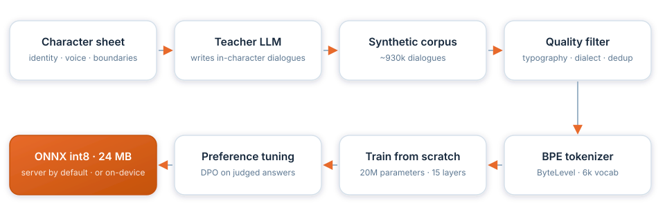
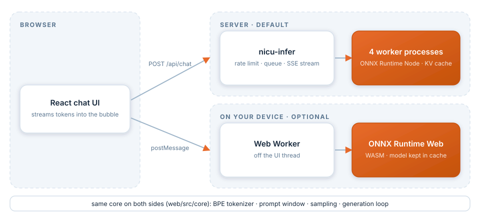

# Nicu

A small, from-scratch Sicilian character AI (20M parameters) and the source of
its chat at **[nicu.chat](https://nicu.chat)** — Nicu 1.2.

## What is this

Nicu is a small language model trained from scratch (no pretrained base, no
fine-tuning of an existing LLM) that plays a single character: **Nicu, a
friendly guy from Catania, Sicily**. He talks about the sea, the grill, his
friends, Sant'Agata — his small world. Ask him anything outside of it (the
capital of France, how to fix your car, world news) and he **deflects
instead of making things up**. That's by design, not a bug: a model this
small can't reliably hold facts about the whole world, so instead of
hallucinating it stays in character and dodges — usually with a joke about
horse-meat polpette.

The model was trained with **distillation**: a large teacher LLM generated a
synthetic corpus of ~930k in-character dialogues (a "character sheet" defines
who Nicu is, his voice, and his boundaries), and the model learned the
character from that corpus, from randomly initialized weights. A final
preference-tuning step (DPO) polished its answers. There is no prompting at
inference time, just a tiny GPT doing next-token prediction.

## Try it

**https://nicu.chat**

Nicu answers **from our server** by default, so you can start typing right
away without downloading anything. One button moves him **onto your device**
(computer, phone or tablet): the 24 MB model is downloaded once and from then
on answers locally, even offline. If the server is busy or unreachable and the
model is already on your device, he answers from there.

## How it was made

<picture>
  <source media="(prefers-color-scheme: dark)" srcset="assets/pipeline-dark.svg">
  
</picture>

- **Character sheet** — a Markdown contract fixing Nicu's identity, voice,
  recurring moves, and the boundary of what he knows.
- **Teacher LLM** — generates in-character dialogues plus deflections for
  out-of-domain prompts, following that contract.
- **Quality filter** — dialect/typography cleanup, dedup, format checks.
- **BPE tokenizer** — trained on the cleaned corpus, 6,000 tokens.
- **Train from scratch** — a 15-layer decoder on ~565k short dialogues plus
  ~365k longer, multi-turn ones (929,500 in total).
- **Preference tuning** — two rounds of DPO on answers ranked by an LLM judge.
- **ONNX export** — dynamic int8, with and without a KV cache (~24 MB each).

## How it runs

<picture>
  <source media="(prefers-color-scheme: dark)" srcset="assets/runtime-dark.svg">
  
</picture>

Both engines run **the same code** (`web/src/core/`: tokenizer, prompt window,
sampler, generation loop), so a given prompt and seed produce the same text on
the server and on a phone.

**Server** (`infer/`) — a small Node 24 HTTP server. `POST /api/chat` takes a
message, the recent history and the sampling parameters, and streams the reply
token by token as server-sent events. Inputs are validated and capped, requests
are queued over four worker processes (each with its own `onnxruntime-node`
session and KV cache), and each client gets 20 requests per minute. Client IPs
are only used as a salted hash, in memory, for that rate limit.

**Device** (`web/src/lib/inference*.ts`) — the model runs through **ONNX
Runtime Web**, pinned to a WASM-only build (no WebGPU) so it works the same
everywhere, including older iOS Safari, which is the whole reason for the pin
(see [`web/README.md`](web/README.md)). It runs inside a **Web Worker** so the
UI thread stays free to animate the chat. Tokenization is a from-scratch
ByteLevel BPE implementation in plain TypeScript (`web/src/core/tokenizer.ts`).

## Model

| | |
|---|---|
| Parameters | 20.6M |
| Layers / heads / embedding dim | 15 / 8 / 320 |
| Vocabulary | 6,000 (ByteLevel BPE) |
| Context | 512 tokens |
| Served file | int8 ONNX, ~24 MB (with KV cache; a cache-less one is the fallback) |
| Weights | [federico-anastasi/nicu-20m](https://huggingface.co/federico-anastasi/nicu-20m) |

Blind LLM-judge pass rate on a 204-case character-fidelity suite: **81.4%**
(68.2% for the same model before preference tuning, measured in the same
round). See [`MODEL_CARD.md`](MODEL_CARD.md) for the details and the limits.

The smaller 5M and 9M models of the earlier family are still on the Hub as
[nicu-5m](https://huggingface.co/federico-anastasi/nicu-5m) and
[nicu-9m](https://huggingface.co/federico-anastasi/nicu-9m); this repository
serves the 20M model.

## Repository

```
web/     the chat (React + TypeScript + Vite): interface, device engine, service worker
infer/   the inference server (Node 24 + onnxruntime-node) and its load/behaviour tests
tools/   export_onnx.py (+ model.py): checkpoint -> ONNX int8, with or without KV cache
assets/  the two diagrams above (gen_diagrams.py regenerates them)
```

The interface and the code comments are in Italian — Nicu only speaks Italian —
while this README and the model card are in English.

## Run locally

Requires Node 24 or later. Download the model files into `web/public/` with the
names that `web/src/core/config.ts` expects (the tokenizer is already in the
repo):

```bash
git clone https://github.com/Federico-Anastasi/nicu-chat.git
cd nicu-chat/web/public
HF=https://huggingface.co/federico-anastasi/nicu-20m/resolve/main
curl -L -o nicu-l-v11-dpo2-s2.kv.int8.onnx $HF/model.kv.int8.onnx
curl -L -o nicu-l-v11-dpo2-s2.int8.onnx    $HF/model.int8.onnx
```

Then start the server and the interface in two terminals:

```bash
cd infer && npm install && PORT=8300 node server.mjs        # http://localhost:8300/api/chat/health
cd web   && npm install && npm run dev                      # http://localhost:5173
```

`npm install` in `web/` also copies ONNX Runtime's `.wasm` binaries into
`web/public/wasm/`. The dev server proxies `/api/chat` to `localhost:8300`
(override with `NICU_INFER=http://host:port`). Without the server, the
"on your device" button still works.

Checks:

```bash
cd web   && npm run build && npm run verify     # tokenizer, prompt, generation and sampling against references
cd infer && NICU_TEST=1 PORT=8300 node server.mjs   # a server that also accepts a fixed seed...
cd infer && npm test                            # ...against which: parity, streaming, limits, load
```

To serve with Docker, put the model files in `web/public/` and build from the
repository root: `docker build -f infer/Dockerfile -t nicu-infer .`.

## What's NOT here

The data generation pipeline (the character sheet, the prompt engine that
seeds the teacher LLM, the corpus itself), the training and evaluation
scripts, and the backend that stores chats when a visitor consents to it. The
web app sends a finished exchange to `/api/log` only with that consent; where
no such backend exists the request fails silently and nothing happens.

## Author

Federico Anastasi — [@FedeAnastasi](https://x.com/FedeAnastasi)

## License

Code: AGPL-3.0-or-later (see `LICENSE`). Model weights: CC-BY-NC-4.0 (see `MODEL_CARD.md`). The
name and logo follow `TRADEMARKS.md`; the full breakdown, including third-party components, is in
`NOTICE.md`.
